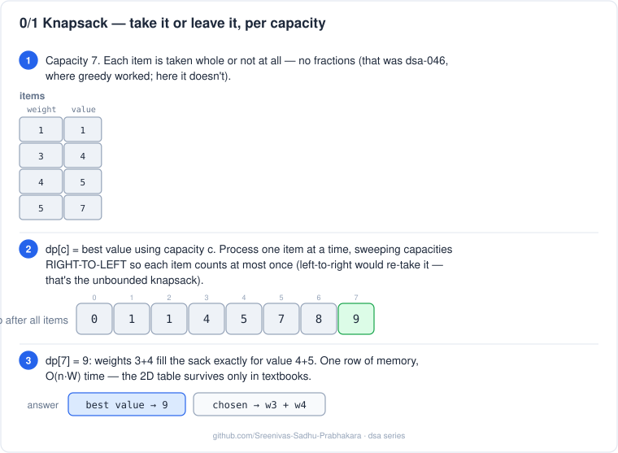

# 0/1 Knapsack

> Striver SDE Sheet 173 · Day 25 DP — one row, swept backwards: the direction of the capacity loop is what encodes "each item once". Go, stdlib only, tested.

## Problem

Items with weights and values, a capacity, each item usable **at most once**: maximize packed value. The template problem for an entire DP family (subset sum, partition, target sum are all its restrictions).

## Approach

The 2D recurrence — best value using the first i items within capacity c — collapses to a single row because row i reads only row i−1. The load-bearing detail is the sweep direction: iterating capacities **downward** means `dp[c−w]` still holds the *previous item round's* value, so an item can't stack on itself. Sweep upward and you've silently implemented the unbounded knapsack (which is exactly how rod cutting / coin change differ — compare #178/#180). One direction flip separates two different problems; that's the thing to actually understand here.

**Complexity:** O(n·capacity) time, O(capacity) space.

## Visual walkthrough

Read the picture top to bottom — each numbered frame is one moment of the algorithm
running on this repo's test example.

## Run

    go test ./...   # verify
    go run .        # demo

---

One of 191 repos solving Striver's SDE Sheet in Go — stdlib only, one problem per repo, every solution tested. Browse the set: [`dsa-*` repos](https://github.com/Sreenivas-Sadhu-Prabhakara?tab=repositories&q=dsa-&type=source).
